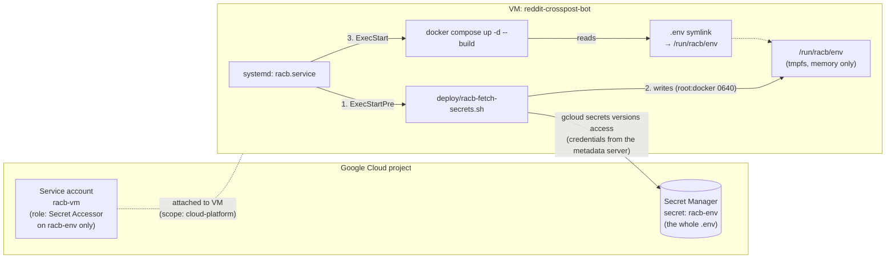

# Storing the bot's secrets in Google Secret Manager

This guide moves the bot's `.env` (4 Reddit account passwords, 4 app secrets, the Postgres password and
the bot settings) out of a plaintext file on the VM and into
[Google Secret Manager](https://cloud.google.com/secret-manager). After the move:

- the VM fetches the secret at boot, through its own service account, with **no key file anywhere**;
- the values only ever live in memory on the VM (`/run` is a tmpfs, wiped on reboot);
- losing or rebuilding the VM no longer loses the secrets;
- changing a value means adding a secret version and restarting one systemd unit.



**Cost:** Secret Manager's free tier is 6 active secret versions and 10,000 access operations per month
per billing account ([pricing](https://cloud.google.com/secret-manager/pricing)). Storing the whole `.env`
as **one** secret uses 1 version and 1 access per boot or restart, so this setup costs nothing as long as
you destroy old versions (step 10).

---

## 0. Before you start

- Run the "local" commands either in **[Cloud Shell](https://shell.cloud.google.com)** (bash, `gcloud`
  already logged in) or on your own machine with the [gcloud CLI](https://cloud.google.com/sdk/docs/install)
  after `gcloud auth login`. Commands are single-line, so they work in both bash and PowerShell unless a
  step shows two variants.
- Commands marked **(on the VM)** run in an SSH session on the VM, which is always bash.
- Your account needs permission to manage IAM, Secret Manager and Compute Engine in the project
  (the project Owner has all of it).
- Expect about **1 minute of bot downtime** in step 5, because a VM must be stopped to change its service account.

## 1. Set variables (local)

bash / Cloud Shell:
```bash
PROJECT_ID="$(gcloud config get-value project)"
ZONE="us-central1-a"
VM="reddit-crosspost-bot"
SECRET="racb-env"
VM_SA="racb-vm@${PROJECT_ID}.iam.gserviceaccount.com"
```

PowerShell:
```powershell
$PROJECT_ID = "$(gcloud config get-value project)"
$ZONE = "us-central1-a"
$VM = "reddit-crosspost-bot"
$SECRET = "racb-env"
$VM_SA = "racb-vm@${PROJECT_ID}.iam.gserviceaccount.com"
```

Check that `PROJECT_ID` is the project that holds the VM (`gcloud compute instances list`). If it isn't,
run `gcloud config set project YOUR_PROJECT_ID` and set the variables again. The zone and VM name above are
the ones from `deploy/instance-flags.yaml`; change them if you created the VM differently.

## 2. Enable the Secret Manager API (local)

```bash
gcloud services enable secretmanager.googleapis.com
```

## 3. Create a dedicated service account for the VM (local)

The VM currently runs as the Compute Engine *default* service account, which usually holds the
project-wide Editor role. A dedicated account that can read exactly one secret and nothing else is the
least-privilege setup.

```bash
gcloud iam service-accounts create racb-vm --display-name="RedditAutoCrosspostBot VM"
```

## 4. Store the current `.env` as the secret (local)

Copy the live `.env` off the VM, upload it, then delete the local copy.

```bash
gcloud compute scp "${VM}:/opt/RedditAutoCrosspostBot/.env" ./racb.env --zone=$ZONE
gcloud secrets create $SECRET --replication-policy=automatic --data-file=racb.env
```

Delete the local copy:
- bash / Cloud Shell: `shred -u racb.env`
- PowerShell: `Remove-Item racb.env`

Then grant the VM's service account read access to **this secret only**. This is not a project-wide grant:

```bash
gcloud secrets add-iam-policy-binding $SECRET --member="serviceAccount:$VM_SA" --role="roles/secretmanager.secretAccessor"
```

## 5. Attach the service account to the VM (local, ~1 minute downtime)

A VM's service account and **access scopes** can only be changed while it is stopped. Secret Manager
requires the `cloud-platform` scope on the VM. That broad scope is safe here: what the VM can actually
reach is still limited by the service account's IAM roles, which is only the one secret.

```bash
gcloud compute instances stop $VM --zone=$ZONE
gcloud compute instances set-service-account $VM --zone=$ZONE --service-account=$VM_SA --scopes=cloud-platform
gcloud compute instances start $VM --zone=$ZONE
```

After the start, Docker brings the bot back up with its old configuration, which still works.

## 6. Test the fetch on the VM (on the VM)

```bash
gcloud compute ssh $VM --zone=$ZONE
```
Then, on the VM:
```bash
cd /opt/RedditAutoCrosspostBot
git pull                                          # brings in deploy/racb-fetch-secrets.sh and deploy/racb.service
sudo sh deploy/racb-fetch-secrets.sh /run/racb/env
sudo cmp .env /run/racb/env && echo "identical"   # the secret must match the file you uploaded
```

If the fetch fails, see [Troubleshooting](#troubleshooting). Nothing has changed for the running bot yet.

## 7. Switch the bot over to the secret (on the VM)

```bash
cd /opt/RedditAutoCrosspostBot
docker compose down
shred -u .env                       # the plaintext copy is now redundant
ln -s /run/racb/env .env            # docker compose keeps reading ".env", which now points into memory
sudo cp deploy/racb.service /etc/systemd/system/racb.service
sudo systemctl daemon-reload
sudo systemctl enable --now racb    # fetch secret, then build and start the stack
```

Why a symlink: `docker-compose.yml` reads `.env` twice, once as the `bot` service's `env_file` and once
for the `${POSTGRES_*}` substitutions in the file itself. A symlink keeps both working without changing
`docker-compose.yml`.

## 8. Verify (on the VM)

```bash
systemctl status racb --no-pager                  # "active (exited)" is correct for this oneshot unit
journalctl -u racb -n 30 --no-pager               # shows "Wrote secret 'racb-env' ..."
docker compose logs --tail 50 bot                 # look for "All bot accounts authenticated successfully."
```

Then prove it survives a reboot:
```bash
sudo reboot
# reconnect after ~1 minute, then:
ls -l /run/racb/env && docker compose -f /opt/RedditAutoCrosspostBot/docker-compose.yml logs --tail 20 bot
```

## 9. Optional: keep secrets out of the Docker image

`COPY . .` in the `Dockerfile` copies the whole project directory into the image. Before this change that
included the plaintext `.env`. With the symlink, the image should only contain a link pointing at a path
that doesn't exist inside the container. To exclude it explicitly, add a `.dockerignore` containing `.env`
(and, while at it, `.git` and `logs`). The repo's `.gitignore` ignores all dotfiles, so committing
`.dockerignore` also needs a `!.dockerignore` line in `.gitignore`.

The bot never needed the file inside the image: Compose's `env_file` passes every value in as environment
variables at runtime.

## 10. Day-to-day operations

**Change a value** (e.g. after changing a bot's Reddit password), locally:
```bash
gcloud secrets versions access latest --secret=$SECRET > racb.env
# edit racb.env
gcloud secrets versions add $SECRET --data-file=racb.env
```
Delete `racb.env` as in step 4, then apply it on the VM with `sudo systemctl restart racb`.

**Clean up old versions** to stay in the free tier. Disabled versions still count as active; only
destroyed ones are free:
```bash
gcloud secrets versions list $SECRET
gcloud secrets versions destroy VERSION_NUMBER --secret=$SECRET
```
Keep the previous version for a few days in case you need to roll back. To roll back, add its contents
again as a new version:
```bash
gcloud secrets versions access VERSION_NUMBER --secret=$SECRET > racb.env
gcloud secrets versions add $SECRET --data-file=racb.env
```
Then delete `racb.env` and run `sudo systemctl restart racb` on the VM.

**See who read the secret:** Data Access audit logs are off by default. Enable them for "Secret Manager
API" under *IAM & Admin → Audit Logs* (Data Read). Accesses then appear in Logs Explorer.

**Deploy new code** (on the VM): `git pull && sudo systemctl restart racb`.

## 11. New VMs

To create a future VM with this setup from the start, add these lines to the flags in
`deploy/instance-flags.yaml`, with your project ID filled in:
```yaml
--service-account: racb-vm@YOUR_PROJECT_ID.iam.gserviceaccount.com
--scopes: cloud-platform
```
Then follow steps 6–8 on the new VM, skipping the `cmp` and `shred` lines.

---

## Troubleshooting

| Symptom | Cause | Fix |
| :--- | :--- | :--- |
| `PERMISSION_DENIED: Permission 'secretmanager.versions.access' denied` | The VM runs as a different service account, or the IAM binding is missing | On the VM, `curl -s -H 'Metadata-Flavor: Google' http://metadata.google.internal/computeMetadata/v1/instance/service-accounts/default/email` must print `racb-vm@...`; otherwise redo step 5. Check the binding with `gcloud secrets get-iam-policy $SECRET`. |
| `ACCESS_TOKEN_SCOPE_INSUFFICIENT` / "insufficient authentication scopes" | The VM lacks the `cloud-platform` scope | Redo step 5. IAM roles cannot widen a narrow scope. |
| `gcloud: not found` in `journalctl -u racb` | gcloud lives somewhere other than `/snap/bin` or `/usr/lib/google-cloud-sdk/bin` | `command -v gcloud` in a login shell, then add that directory to `PATH` in `deploy/racb-fetch-secrets.sh`. |
| `racb.service` keeps restarting right after boot | Network or metadata server not ready yet | It retries every 30 s on its own (`Restart=on-failure`). A persistent failure is one of the rows above. |
| `docker compose` (without sudo): `open .env: permission denied` | Your user is not in the `docker` group | `sudo usermod -aG docker $USER`, then log in again. |
| `docker compose`: `.env` not found, or variables "not set" | `/run/racb/env` hasn't been fetched since boot | `sudo systemctl restart racb`. |

---

## Optional: letting Claude Code cloud sessions run the integration tests

The same secret can supply credentials to a [Claude Code cloud session](https://code.claude.com/docs/en/claude-code-on-the-web),
so it can run `pytest -m integration`. A cloud session is not a GCP VM and has no metadata server, so it
needs a **service account key**: a long-lived credential that Google recommends avoiding where possible.
Weigh it honestly:

- **Gains over pasting the 8 Reddit values into the session's environment:** one source of truth
  (rotating a Reddit password means updating only the secret), one place to cut access (delete the key),
  and audit logs of every fetch if you enable them.
- **Doesn't change:** whoever holds the key can read every value in the secret, including the bots'
  passwords. Reddit refresh tokens would narrow what those values allow.

Setup, locally:
```bash
gcloud iam service-accounts create racb-claude --display-name="RedditAutoCrosspostBot Claude Code sessions"
gcloud secrets add-iam-policy-binding $SECRET --member="serviceAccount:racb-claude@${PROJECT_ID}.iam.gserviceaccount.com" --role="roles/secretmanager.secretAccessor"
gcloud iam service-accounts keys create racb-claude-key.json --iam-account="racb-claude@${PROJECT_ID}.iam.gserviceaccount.com"
```
If key creation is refused with `constraints/iam.disableServiceAccountKeyCreation`, an organization policy
forbids keys. Personal projects without an organization don't have this policy.

Base64-encode the key so it fits on a single line:
- bash / Cloud Shell: `base64 -w0 racb-claude-key.json`
- PowerShell: `[Convert]::ToBase64String([IO.File]::ReadAllBytes("racb-claude-key.json"))`

Then, in the cloud environment's settings (environment menu in the session title bar → **Edit**):
1. Add environment variables `RACB_GCP_SA_KEY` (the base64 text) and `RACB_GCP_PROJECT` (your project ID).
2. Under **Network access**, allow `reddit.com`, `www.reddit.com`, `oauth.reddit.com`, `i.redd.it`,
   `preview.redd.it`, `i.imgur.com` and `imgur.com`. The image-upload test also needs Reddit's upload
   host (`reddit-uploaded-media.s3-accelerate.amazonaws.com`) and websocket hosts; `*.reddit.com` and
   `*.redd.it` are simpler if wildcards are accepted.
3. Delete the local key file (`shred -u racb-claude-key.json` / `Remove-Item racb-claude-key.json`).

A **new** session picks up the variables. Inside it, the tests run with:
```bash
printf '%s' "$RACB_GCP_SA_KEY" | base64 -d > /tmp/racb-sa.json
gcloud auth activate-service-account --key-file=/tmp/racb-sa.json && rm /tmp/racb-sa.json
sh deploy/racb-fetch-secrets.sh .env      # .env is gitignored; the bot's dotenv loading finds it
pytest -m integration
```

To revoke a session's access at any time, list the keys and delete them:
```bash
gcloud iam service-accounts keys list --iam-account="racb-claude@${PROJECT_ID}.iam.gserviceaccount.com"
gcloud iam service-accounts keys delete KEY_ID --iam-account="racb-claude@${PROJECT_ID}.iam.gserviceaccount.com"
```
