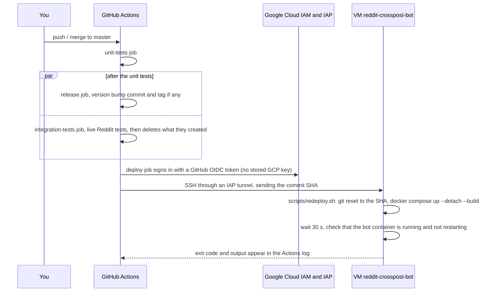

# Automatic Deployment to the VM

Every push to `master` that passes the unit tests and the live integration tests is rebuilt
and restarted on the Google Cloud VM (`reddit-crosspost-bot`, zone `us-central1-a`) by the `deploy` job in
[`.github/workflows/tests.yml`](../.github/workflows/tests.yml). This guide explains how it works and walks
through the one-time setup. Until the setup is done, the job is skipped and deploying stays manual.

- [How it works](#how-it-works)
- [Security model](#security-model)
- [Prerequisites](#prerequisites)
- [Setup](#setup)
  - [Step 1: Merge this change and update the VM by hand once](#step-1-merge-this-change-and-update-the-vm-by-hand-once)
  - [Step 2: Find your Linux user on the VM](#step-2-find-your-linux-user-on-the-vm)
  - [Step 3: Run the setup script in Cloud Shell](#step-3-run-the-setup-script-in-cloud-shell)
  - [Step 4: Save the GitHub variables and secrets (only if the script could not)](#step-4-save-the-github-variables-and-secrets-only-if-the-script-could-not)
  - [Step 5: Test it](#step-5-test-it)
- [Day-to-day use](#day-to-day-use)
- [Troubleshooting](#troubleshooting)
- [Removing it](#removing-it)
- [What the setup script does, command by command](#what-the-setup-script-does-command-by-command)

---

## How it works



1. The `deploy` job runs only when two things passed for the pushed commit:
   - `unit-tests`;
   - `integration-tests`: the live tests (`uv run pytest -m integration`), which log in as all 4 bot accounts
     and post in the private test subreddits r/racb_test_1 and r/racb_test_2. Each test deletes what it posts.

   The tests also record every post and comment they create in a manifest file. The job's last step,
   `scripts/delete_test_artifacts.py --strict`, deletes any recorded item that is still on Reddit, as the
   bot that wrote it. It only looks up those items, so it takes seconds, and it never touches anything
   another run created. It runs even when the tests failed or were cancelled, since a killed test never
   reaches its own cleanup. `--strict` fails the job, and so blocks the deploy, if a recorded item could not
   be deleted.

   Only one run's integration tests post at a time. When a newer push reaches `integration-tests`, it
   cancels the older run's tests instead of waiting; the older run still deletes what it created, and the
   newer commit is the one that gets deployed. If the newer commit fails its tests, though, the older one is
   not deployed either; the next passing push deploys.
2. It deploys the commit `release` ended on: the `chore(release)` commit when a version was bumped, so the
   version in the bot's User-Agent is right, or the tested commit itself when nothing was released. If
   someone pushed to `master` while the run was going, `release` sees the newer, not yet tested commit;
   this run then deploys nothing, and the run for the newer push tests and deploys it.
3. It signs in to Google Cloud with
   [Workload Identity Federation](https://cloud.google.com/iam/docs/workload-identity-federation): GitHub
   issues a short-lived OIDC token for the run, and Google trades it for a short-lived token of the
   `github-deployer` service account. No Google key is stored anywhere.
4. It opens an SSH connection to the VM through
   [IAP TCP forwarding](https://cloud.google.com/iap/docs/using-tcp-forwarding), so the VM does not need port
   22 open to the internet and its changing external IP does not matter.
5. On the VM, the deploy key can only run [`scripts/redeploy.sh`](../scripts/redeploy.sh). That script
   fetches `master`, resets the checkout to the requested commit, runs `docker compose up --detach --build`,
   waits 30 seconds and fails the job if the bot container is not running or has restarted (a crash loop).
   It then prunes the old, now unused image so the 30 GB disk does not fill up.
6. Compose builds the new image while the old container keeps running and only then swaps containers, so
   the bot is down for a few seconds per deploy. PostgreSQL is not restarted unless its definition changed.

Building happens on the VM, as it does by hand today. That is deliberate: the image contains `.env` with
all the bot passwords ([`AGENTS.md`](../AGENTS.md) section 8), so it must never be pushed to a registry.

## Security model

| Secret or permission | Where it lives | What someone who steals it can do |
| :--- | :--- | :--- |
| Deploy SSH private key | GitHub Actions secret `VM_DEPLOY_SSH_KEY` | Only run `scripts/redeploy.sh` on the VM, i.e. redeploy a commit that is already on `master`. The key is pinned to that script with an sshd forced command and `restrict` (no shell, no pty, no port or agent forwarding). It also needs the Google sign-in below to reach the VM at all. |
| Google sign-in | Nothing stored. Only workflow runs of `Toldry/RedditAutoCrosspostBot` on `refs/heads/master` can get a token. | The service account can open IAP tunnels to VMs in the project (`roles/iap.tunnelResourceAccessor`) and read Compute Engine metadata (`roles/compute.viewer`). It cannot change anything in the project. |
| VM host key | GitHub Actions variable `VM_SSH_HOST_KEY` | Public; it lets the job check that it is talking to the real VM. |
| Passwords and client secrets of the 4 bot accounts | GitHub Actions secrets `PASSWORD`, `APP_CLIENT_SECRET`, `PASSWORD__SUB_DOESNT_EXIST`, ... (the 8 names in `.env`) | Log in as the bots. This is a new copy of these credentials outside the VM, needed because the integration tests log in as the real accounts. GitHub never passes secrets to workflows triggered from forks, and `integration-tests` only runs on pushes to `master`. A collaborator with write access could still read them with a workflow they push to a branch, as with any repository secret. |

Pull requests, including those from forks, cannot deploy: the `deploy` job only runs on pushes to `master`,
and the Google provider rejects tokens for any other branch or repository. Anyone who can push to `master`
can deploy, which was already true, since a push to `master` is what gets deployed.

## Prerequisites

- Owner (or editor plus IAM admin) rights on the Google Cloud project `reddit-autocrosspostbot`.
- Admin rights on the GitHub repository, to add Actions variables and secrets.
- The bot already deployed by hand on the VM: a checkout of this repository at `/opt/RedditAutoCrosspostBot`
  on branch `master`, with its `.env`, started with `docker compose up -d --build`, as described in the
  [README](../README.md).
- Google Cloud Shell (https://shell.cloud.google.com), which already has `gcloud`, `git` and `ssh-keygen`
  signed in as you. Any Linux or macOS shell with the Google Cloud CLI works too. On Windows, use Cloud Shell
  or WSL; the setup script is bash.

## Setup

### Step 1: Merge this change and update the VM by hand once

The VM needs the new scripts before the setup can authorize the deploy key. Merging is safe: the `deploy` job
is skipped until the `AUTO_DEPLOY` variable is `true`.

1. Merge the pull request that adds this file.
2. SSH into the VM the way you normally do (for example the **SSH** button on the VM's page in the console,
   https://console.cloud.google.com/compute/instances) and update the checkout:

   ```bash
   cd /opt/RedditAutoCrosspostBot
   git status            # must be on master with no edited tracked files
   git pull origin master
   docker compose up -d --build
   ls -l scripts/redeploy.sh scripts/authorize_deploy_key.sh   # both must show x (executable)
   ```

### Step 2: Find your Linux user on the VM

The deploy runs as the same Linux account you use today, so the checkout's file ownership and its
membership of the `docker` group stay as they are. In the same SSH session:

```bash
whoami                      # e.g. toldry -- this is VM_USER
id -nG | grep -w docker     # must print a line; if not, see Troubleshooting
stat -c %U /opt/RedditAutoCrosspostBot   # should print the same user
```

### Step 3: Run the setup script in Cloud Shell

Open Cloud Shell (https://shell.cloud.google.com) and run:

```bash
git clone https://github.com/Toldry/RedditAutoCrosspostBot.git
cd RedditAutoCrosspostBot
gcloud config set project reddit-autocrosspostbot
gh auth login          # optional: lets the script save the GitHub settings for you (see below)
VM_USER=toldry ./scripts/setup_auto_deploy.sh     # use the user from step 2
```

The script ([`scripts/setup_auto_deploy.sh`](../scripts/setup_auto_deploy.sh)) is safe to re-run. It:

1. enables the IAM, IAM Credentials, Security Token Service, IAP and Compute Engine APIs;
2. creates the `github-deployer` service account and grants it `roles/iap.tunnelResourceAccessor` and
   `roles/compute.viewer`;
3. creates the workload identity pool `github` and the provider `racb-repo`, which trusts GitHub's OIDC
   tokens only for this repository on `master`, and lets that repository act as the service account;
4. creates the firewall rule `allow-iap-ssh`, which allows SSH only from Google's IAP range `35.235.240.0/20`;
5. generates a new ed25519 deploy key pair;
6. SSHes into the VM as `VM_USER` through IAP and runs
   [`scripts/authorize_deploy_key.sh`](../scripts/authorize_deploy_key.sh), which adds the public key to
   `~/.ssh/authorized_keys` pinned to `scripts/redeploy.sh` and prints the VM's SSH host key;
7. if `gh` is installed and signed in, copies the 8 bot credentials from the VM's `.env` (over the same SSH
   connection) and saves them, the deploy key and the variables listed in step 4 to GitHub. Otherwise it
   writes the private key to `./racb-deploy-key` and prints the values to enter by hand.

The defaults match this deployment. Override any of them with an environment variable in front of the
command, e.g. `GCP_ZONE=europe-west1-b VM_USER=toldry ./scripts/setup_auto_deploy.sh`:

| Variable | Default |
| :--- | :--- |
| `GCP_PROJECT_ID` | `reddit-autocrosspostbot` |
| `GCP_ZONE` | `us-central1-a` |
| `VM_NAME` | `reddit-crosspost-bot` |
| `VM_USER` | *(required)* |
| `VM_REPO_DIR` | `/opt/RedditAutoCrosspostBot` |
| `GITHUB_REPOSITORY` | `Toldry/RedditAutoCrosspostBot` |
| `SERVICE_ACCOUNT_NAME` | `github-deployer` |
| `WORKLOAD_IDENTITY_POOL_ID` | `github` |
| `WORKLOAD_IDENTITY_PROVIDER_ID` | `racb-repo` |
| `FIREWALL_RULE_NAME` | `allow-iap-ssh` |

The first time, `gcloud compute ssh` may offer to create an SSH key for your Cloud Shell account and add it to
the project. Accept; that key is yours, separate from the deploy key.

### Step 4: Save the GitHub variables and secrets (only if the script could not)

Skip this step if the script ended with "Done. The next push to master deploys automatically."

Otherwise open the repository on GitHub, then **Settings > Secrets and variables > Actions**
(https://github.com/Toldry/RedditAutoCrosspostBot/settings/variables/actions), and add what the script
printed:

| Kind | Name | Value |
| :--- | :--- | :--- |
| Variable | `GCP_PROJECT_ID` | `reddit-autocrosspostbot` |
| Variable | `GCP_ZONE` | `us-central1-a` |
| Variable | `VM_NAME` | `reddit-crosspost-bot` |
| Variable | `VM_USER` | your user from step 2 |
| Variable | `VM_SSH_HOST_KEY` | `ssh-ed25519 AAAA...`, printed by the script |
| Variable | `GCP_WORKLOAD_IDENTITY_PROVIDER` | `projects/<project number>/locations/global/workloadIdentityPools/github/providers/racb-repo` |
| Variable | `GCP_DEPLOY_SERVICE_ACCOUNT` | `github-deployer@reddit-autocrosspostbot.iam.gserviceaccount.com` |
| Variable | `AUTO_DEPLOY` | `true` |
| Secret | `VM_DEPLOY_SSH_KEY` | the whole content of `racb-deploy-key`, including the `BEGIN` and `END` lines |
| Secret | `PASSWORD`, `APP_CLIENT_SECRET`, `PASSWORD__SUB_DOESNT_EXIST`, `APP_CLIENT_SECRET__SUB_DOESNT_EXIST`, `PASSWORD__SAME_SUBREDDIT`, `APP_CLIENT_SECRET__SAME_SUBREDDIT`, `PASSWORD__SAME_POST`, `APP_CLIENT_SECRET__SAME_POST` | one secret each, with the same name and value as in the VM's `.env` (see [`.env.example`](../.env.example)) |

Then delete the key file: `rm racb-deploy-key`.

With the GitHub CLI on your own computer instead of the web page, the secret is set like this:

```bash
gh secret set VM_DEPLOY_SSH_KEY --repo Toldry/RedditAutoCrosspostBot < racb-deploy-key
```

```powershell
Get-Content racb-deploy-key -Raw | gh secret set VM_DEPLOY_SSH_KEY --repo Toldry/RedditAutoCrosspostBot
```

the 8 bot credentials, from a copy of `.env` on your computer, like this (only those lines are sent):

```bash
grep -E '^(PASSWORD|APP_CLIENT_SECRET)(__[A-Z_]+)?=' .env > reddit-secrets.env
gh secret set --repo Toldry/RedditAutoCrosspostBot --env-file reddit-secrets.env
rm reddit-secrets.env
```

```powershell
Select-String -Path .env -Pattern '^(PASSWORD|APP_CLIENT_SECRET)(__[A-Z_]+)?=' |
  ForEach-Object { $_.Line } | Set-Content reddit-secrets.env
gh secret set --repo Toldry/RedditAutoCrosspostBot --env-file reddit-secrets.env
Remove-Item reddit-secrets.env
```

and each variable like this (same syntax in both shells):

```bash
gh variable set AUTO_DEPLOY --repo Toldry/RedditAutoCrosspostBot --body true
```

### Step 5: Test it

1. Push any commit to `master` (a docs edit is enough), or merge a pull request.
2. Open the run under **Actions** (https://github.com/Toldry/RedditAutoCrosspostBot/actions). After
   `unit-tests`, `release` and `integration-tests` (its last step should log
   `=== Summary: Successfully deleted ...`), the `deploy` job should end with
   `Deployed <sha>; the bot is running.`
3. On the VM, `docker compose ps` should show the `racb` container recently created, and
   `docker compose logs -f bot` the bot starting up.

To test the deploy path without waiting for a push, re-run only the `deploy` job of the latest `master` run
(**Re-run jobs > Re-run failed jobs** or the re-run icon next to the job).

## Day-to-day use

- **Normal flow:** merge to `master`. Nothing else to do. A failed deploy shows as a red `deploy` job, and
  GitHub emails you about the failed run.
- **A failing integration test blocks the deploy**, and so does a recorded test post or comment that could
  not be deleted (see Troubleshooting). The version is still released, since `release` does not wait for the integration tests. Fix forward;
  the next push to `master` tests and deploys again. If Reddit itself is having a bad day, re-run the
  failed `integration-tests` job; `deploy` runs once it passes.
- **Pause auto-deploy:** set the `AUTO_DEPLOY` variable to anything other than `true` (or delete it). Pushes
  still run the unit tests and releases; `integration-tests` and `deploy` are skipped. Set it back to `true` to resume; the next push
  deploys everything merged in between.
- **Roll back:** re-run the `deploy` job of an older successful run; it redeploys that run's commit. Or, on
  the VM: `./scripts/redeploy.sh <full commit sha>`. The next push to `master` deploys the latest code again,
  so revert the bad commit on `master` too.
- **Deploy by hand:** on the VM, `cd /opt/RedditAutoCrosspostBot && ./scripts/redeploy.sh` deploys the latest
  `origin/master` with the same checks. Plain `git pull && docker compose up -d --build` still works too.
  Deploys never overlap: `redeploy.sh` takes a lock, and the `deploy` job runs one at a time.
- **Rotate the deploy key:** run step 3 again. It replaces the key on the VM and, with `gh`, in GitHub.
- **Changing `.env`:** still a manual step on the VM (edit it, then `docker compose up -d --build` or
  `./scripts/redeploy.sh`). Deploys never touch `.env`, because it is git-ignored.
- **Editing files on the VM:** don't. `redeploy.sh` refuses to run if tracked files have local changes, rather
  than silently throwing them away, so a hand edit blocks deploys until you commit it or run
  `git checkout -- .`.

## Troubleshooting

| Symptom in the `deploy` log | Cause and fix |
| :--- | :--- |
| `google-github-actions/auth` fails with `unauthorized_client` or `The given credential is rejected by the attribute condition` | The run was not on `master` of `Toldry/RedditAutoCrosspostBot`, or the repository was renamed. Re-run step 3 with the right `GITHUB_REPOSITORY` (case-sensitive). |
| `Permission 'iam.serviceAccounts.getAccessToken' denied` | The `workloadIdentityUser` binding is missing. Re-run step 3. IAM changes can take a few minutes to apply. |
| `failed to connect to backend` or `4033: not authorized` from `start-iap-tunnel` | Firewall rule or IAP role missing. Check `gcloud compute firewall-rules describe allow-iap-ssh` and that the rule's network is the VM's network. Re-run step 3. |
| `Host key verification failed` | The VM's host key changed (VM recreated). Re-run step 3, or update `VM_SSH_HOST_KEY` with the output of `cut -d ' ' -f 1,2 /etc/ssh/ssh_host_ed25519_key.pub` on the VM. |
| `Permission denied (publickey)` | The deploy key is not in `~/.ssh/authorized_keys` of `VM_USER`, or `VM_USER` is wrong. If the project or VM has OS Login on (`enable-oslogin=TRUE` metadata), your username differs from the metadata-key one, and this setup has not been tested under OS Login. Run step 2 again on the VM and re-run step 3. |
| `redeploy: tracked files were edited on the VM` | Someone edited a tracked file on the VM. Inspect with `git status` / `git diff`, then commit the change through a pull request or discard it with `git checkout -- .`. |
| `redeploy: the checkout ... must be on branch master` | `git checkout master` on the VM. |
| `redeploy: local master has commits that are not on origin/master` | Commits were made on the VM. Push them through a pull request, or drop them with `git reset --hard origin/master`. |
| `redeploy: the bot is not running cleanly` | The new code crashes on start. The last 50 log lines are in the job log. Fix forward, or roll back (see above). |
| `permission denied while trying to connect to the Docker daemon socket` | `VM_USER` is not in the `docker` group: `sudo usermod -aG docker <user>`, then log out and in. |
| `integration-tests` fails at `Live integration tests` | A real failure, or Reddit being unavailable. The pytest output names the test. Integration tests that fail on login usually mean a bot credential secret is missing or out of date; update it to match the VM's `.env`. |
| `integration-tests` fails at `Delete the posts and comments the tests created` | The script lists the problems at the end of its log (`could not look up ...`, `could not delete ...`). Usually Reddit was briefly unavailable: re-run the job. To find leftovers from older runs, or to diagnose a 404 on delete (subreddit private or banned, account shadowbanned), run the full history sweep `uv run python scripts/cleanup_test_history.py --limit 0` locally. |
| `deploy` is skipped | `AUTO_DEPLOY` is not exactly `true`, the push was not to `master`, `integration-tests` or `release` failed (for example its push lost a race with another merge), or `master` moved on during the run (the newer push's run deploys it; look for the `master moved past` notice in `release`). Also: a newer push cancels an older run's `integration-tests` that is still running, which skips that run's deploy; the newer run deploys instead. |
| `no space left on device` during the build | `docker system df` on the VM, then `docker builder prune` and `docker image prune -a` (the running bot's image is kept). |

## Removing it

1. Delete the `AUTO_DEPLOY` variable (the jobs are then skipped), the `VM_DEPLOY_SSH_KEY` secret and the 8 bot
   credential secrets in GitHub.
2. On the VM, remove the deploy key: `sed -i '/ racb-github-deploy$/d' ~/.ssh/authorized_keys`.
3. In Cloud Shell, delete the Google Cloud resources:

   ```bash
   gcloud compute firewall-rules delete allow-iap-ssh
   gcloud iam workload-identity-pools delete github --location=global
   gcloud iam service-accounts delete github-deployer@reddit-autocrosspostbot.iam.gserviceaccount.com
   ```

   A deleted pool keeps its name reserved for 30 days; to set up again within that window, undelete it with
   `gcloud iam workload-identity-pools undelete github --location=global`.

## What the setup script does, command by command

For reference, or to do the setup by hand. `$PROJECT_NUMBER` is
`gcloud projects describe reddit-autocrosspostbot --format='value(projectNumber)'`.

```bash
gcloud services enable iam.googleapis.com iamcredentials.googleapis.com sts.googleapis.com \
  iap.googleapis.com compute.googleapis.com

gcloud iam service-accounts create github-deployer
for role in roles/iap.tunnelResourceAccessor roles/compute.viewer; do
  gcloud projects add-iam-policy-binding reddit-autocrosspostbot --role="$role" \
    --member=serviceAccount:github-deployer@reddit-autocrosspostbot.iam.gserviceaccount.com
done

gcloud iam workload-identity-pools create github --location=global
gcloud iam workload-identity-pools providers create-oidc racb-repo --location=global \
  --workload-identity-pool=github --issuer-uri=https://token.actions.githubusercontent.com \
  --attribute-mapping=google.subject=assertion.sub,attribute.repository=assertion.repository,attribute.ref=assertion.ref \
  --attribute-condition="assertion.repository == 'Toldry/RedditAutoCrosspostBot' && assertion.ref == 'refs/heads/master'"
gcloud iam service-accounts add-iam-policy-binding \
  github-deployer@reddit-autocrosspostbot.iam.gserviceaccount.com --role=roles/iam.workloadIdentityUser \
  --member="principalSet://iam.googleapis.com/projects/$PROJECT_NUMBER/locations/global/workloadIdentityPools/github/attribute.repository/Toldry/RedditAutoCrosspostBot"

gcloud compute firewall-rules create allow-iap-ssh --network=default --direction=INGRESS \
  --action=allow --rules=tcp:22 --source-ranges=35.235.240.0/20

ssh-keygen -t ed25519 -N '' -C racb-github-deploy -f racb-deploy-key
# then, on the VM as VM_USER:
/opt/RedditAutoCrosspostBot/scripts/authorize_deploy_key.sh "$(cat racb-deploy-key.pub)"
```

The resulting line in `~/.ssh/authorized_keys` on the VM looks like this:

```text
command="/opt/RedditAutoCrosspostBot/scripts/redeploy.sh",restrict ssh-ed25519 AAAA... racb-github-deploy
```

Further reading:
- GitHub OIDC with Google Cloud: https://docs.github.com/en/actions/security-for-github-actions/security-hardening-your-deployments/configuring-openid-connect-in-google-cloud-platform
- `google-github-actions/auth`: https://github.com/google-github-actions/auth
- IAP TCP forwarding: https://cloud.google.com/iap/docs/using-tcp-forwarding
- sshd forced commands and `restrict`: https://man.openbsd.org/sshd#AUTHORIZED_KEYS_FILE_FORMAT
