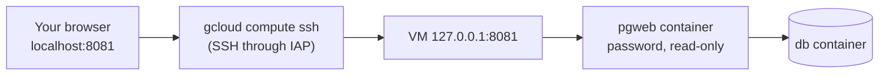

# Viewing the database in a browser

The optional `pgweb` service in [`docker-compose.yml`](../docker-compose.yml) runs
[pgweb](https://github.com/sosedoff/pgweb), a small web viewer for PostgreSQL. You can browse tables, run
`SELECT` queries and export results as CSV or JSON. It uses about 10 MB of memory.

It is locked down three ways:

- **Not on the internet.** Like the database, it listens on the VM's `127.0.0.1:8081` only. You reach it
  through an SSH tunnel, so no firewall rule is needed and nothing new is exposed.
- **Password.** The page asks for a user name and password (HTTP basic auth), set in the VM's `.env`. The
  service refuses to start while the password is empty, because pgweb would otherwise serve without a login.
- **Read-only.** It runs with `--readonly`: every query runs in a read-only transaction, and queries containing
  `INSERT`, `UPDATE`, `DELETE`, `DROP` and similar keywords are rejected. `--lock-session` stops it from being
  used to connect to any other database. To change data, use `psql` (see [AGENTS.md](../AGENTS.md)).



## One-time setup on the VM

SSH into the VM (for example the **SSH** button at https://console.cloud.google.com/compute/instances) and add a
password to `.env`:

```bash
cd /opt/RedditAutoCrosspostBot
nano .env
```

```dotenv
PGWEB_AUTH_USER=admin
PGWEB_AUTH_PASS=pick-a-long-random-password
```

Then start the viewer. It is in the `viewer` profile, so a plain `docker compose up` (including automatic
deploys) does not start it, and does not stop it once it is running. It restarts with the VM.

```bash
docker compose --profile viewer up -d pgweb
docker compose logs pgweb               # should end with "Starting server..."
```

## Opening it

On your computer, with the [Google Cloud CLI](https://cloud.google.com/sdk/docs/install) signed in, open the
tunnel and leave it running. The same command works in bash and PowerShell:

```bash
gcloud compute ssh reddit-crosspost-bot --project reddit-autocrosspostbot --zone us-central1-a --tunnel-through-iap --ssh-flag="-N" --ssh-flag="-L 8081:localhost:8081"
```

Then browse to http://localhost:8081 and log in with `PGWEB_AUTH_USER` and `PGWEB_AUTH_PASS`. Press Ctrl+C in
the terminal to close the tunnel.

`--tunnel-through-iap` uses the `allow-iap-ssh` firewall rule that the
[automatic deployment setup](./auto-deploy.md) created, so it works even though port 22 is not open to the
internet. If local port 8081 is taken, use another one on the left, e.g. `-L 9000:localhost:8081` and
http://localhost:9000.

## Stopping or removing it

```bash
docker compose stop pgweb               # until the next `--profile viewer up`
docker compose rm -sf pgweb             # remove the container
```

## Troubleshooting

| Symptom | Fix |
| --- | --- |
| `docker compose logs pgweb` says `Set PGWEB_AUTH_PASS in .env` | Add the password to `.env` in the checkout directory, then run the `up` command again. |
| Browser shows "connection refused" | The tunnel is not running, or pgweb is not: check `docker compose ps pgweb` on the VM. |
| `4033: not authorized` or `failed to connect to backend` from gcloud | Your Google account needs IAP access and the `allow-iap-ssh` firewall rule must exist; see the troubleshooting table in [auto-deploy.md](./auto-deploy.md). |
| `query contains keywords not allowed in read-only mode` | Expected for writes. pgweb also rejects a `SELECT` that merely mentions such a word, e.g. in a string. |
