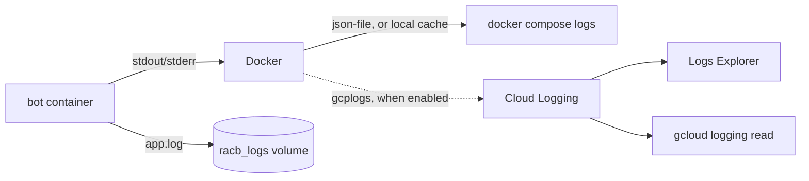

# Reading the bot's logs

The bot writes every log line to its container's output and to `logs/app.log` (volume `racb_logs`, 6 files
of 5 MB). There are two ways to read them:

| | `docker compose logs` over SSH | Google Cloud Logging |
|---|---|---|
| Setup | none | one check, one line in `.env` (below) |
| Where | a shell on the VM | the Cloud Console, or `gcloud` on any computer |
| Search | `grep` | query language, by time range |
| History | the last 30 MB of output (Docker's rotation), plus `app.log` | 30 days |
| Cost | free | free: 50 GiB a month of logs are free, and the bot writes far less |



## Over SSH

Same command in bash and PowerShell. Use your VM name, zone and project
(`deploy/instance-flags.yaml` creates `reddit-crosspost-bot` in `us-central1-a`):

```bash
gcloud compute ssh reddit-crosspost-bot --zone us-central1-a
cd /opt/RedditAutoCrosspostBot
docker compose logs -f --tail 200 bot     # follow live; Ctrl+C to stop
docker compose logs --since 24h bot | grep -E 'ERROR|CRITICAL'
```

`app.log` survives container rebuilds, so it reaches further back than `docker compose logs` after a deploy:

```bash
docker compose exec bot tail -n 200 logs/app.log
```

## In Google Cloud Logging

Docker's `gcplogs` driver sends each line of the bot's output straight to Cloud Logging. There is no agent to
install, which matters on the 1 GB `e2-micro` (the Ops Agent would also work, but it runs its own collector
processes in the VM's limited memory). `docker-compose.gcp.yml` switches the bot to that driver; the database
keeps logging locally.

### 1. Check that the VM may write logs

The bot does not start when the driver cannot reach Cloud Logging, so check before turning it on. On the VM:

```bash
docker run --rm --log-driver=gcplogs alpine echo "racb logging test"
```

If it prints `racb logging test` and exits without an error, it worked, and the line appears in the Logs
Explorer within a minute. If it fails with `unable to connect or authenticate with Google Cloud Logging`, the VM's service
account is missing access. From your own computer (same in bash and PowerShell), see which account and scopes
the VM has:

```bash
gcloud compute instances describe reddit-crosspost-bot --zone us-central1-a --format="yaml(serviceAccounts)"
```

- The scopes must include `https://www.googleapis.com/auth/logging.write` (the default scopes do), or
  `cloud-platform`. Changing scopes needs the VM stopped:
  `gcloud compute instances set-service-account reddit-crosspost-bot --zone us-central1-a --scopes=default`
  (add `--service-account=<email>` to keep the current account).
- The account needs the **Logs Writer** role. Grant it with:
  `gcloud projects add-iam-policy-binding <project-id> --member=serviceAccount:<email> --role=roles/logging.logWriter`

### 2. Turn it on

Add this line to `.env` in the checkout on the VM, then recreate the bot:

```bash
echo 'COMPOSE_FILE=docker-compose.yml:docker-compose.gcp.yml' >> .env
docker compose up -d
```

`.env` is not in git, so deploys keep the setting. `docker compose logs bot` keeps working, from the copy
Docker caches locally. To turn it off, delete the line and run `docker compose up -d` again.

### 3. Read the logs

In the Cloud Console, open **Logging > Logs Explorer** (https://console.cloud.google.com/logs/query), turn on
**Show query**, paste this into the query editor (not the search bar at the top, which wraps text in a
full-text `SEARCH()`), and click **Run query**. **Stream logs** follows new lines live.

```
log_id("gcplogs-docker-driver")
```

Errors only:

```
log_id("gcplogs-docker-driver") AND jsonPayload.message:("ERROR" OR "CRITICAL")
```

From any computer with `gcloud`, newest first. In bash, and in PowerShell 7.3 or later:

```bash
gcloud logging read 'log_id("gcplogs-docker-driver")' --freshness=1h --limit=100 --format="value(jsonPayload.message)"
gcloud logging read 'log_id("gcplogs-docker-driver") AND jsonPayload.message:"ERROR"' --freshness=7d --format="value(timestamp,jsonPayload.message)"
```

Windows PowerShell 5.1 drops double quotes inside arguments to programs, so escape them there:

```powershell
gcloud logging read 'log_id(\"gcplogs-docker-driver\")' --freshness=1h --limit=100 --format="value(jsonPayload.message)"
```

Each entry's `jsonPayload` also holds the container's name and image, and the VM is its resource.
Python's `logging` writes to stderr and the driver sends no severity, so filter on the `[ERROR   ]` text in
the message rather than on the entry's severity.

### Troubleshooting

| Symptom | Cause and fix |
|---|---|
| A deploy fails with `the bot is not running cleanly` and `docker compose up` printed `unable to connect or authenticate with Google Cloud Logging` | The VM lost access to Cloud Logging, or Cloud Logging was unreachable when the container started. Fix access (step 1), or delete the `COMPOSE_FILE` line from `.env` and run `docker compose up -d` to log locally again. |
| No entries in the Logs Explorer, but the bot runs | Check that the query is in the query editor as `log_id("gcplogs-docker-driver")` and not a `SEARCH(...)` from the search bar, and the time range of the query. Then check that `docker inspect racb --format '{{.HostConfig.LogConfig.Type}}'` prints `gcplogs`. If it prints `json-file`, the `COMPOSE_FILE` line is missing or the bot was not recreated. |
